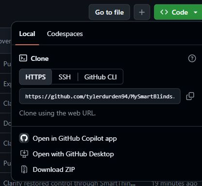
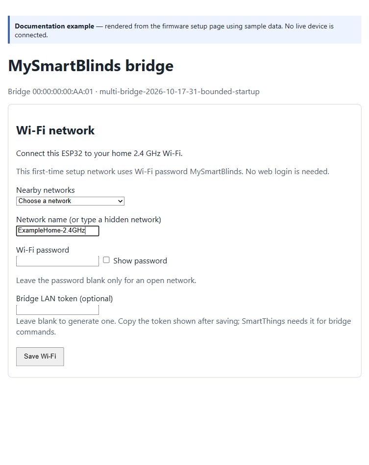
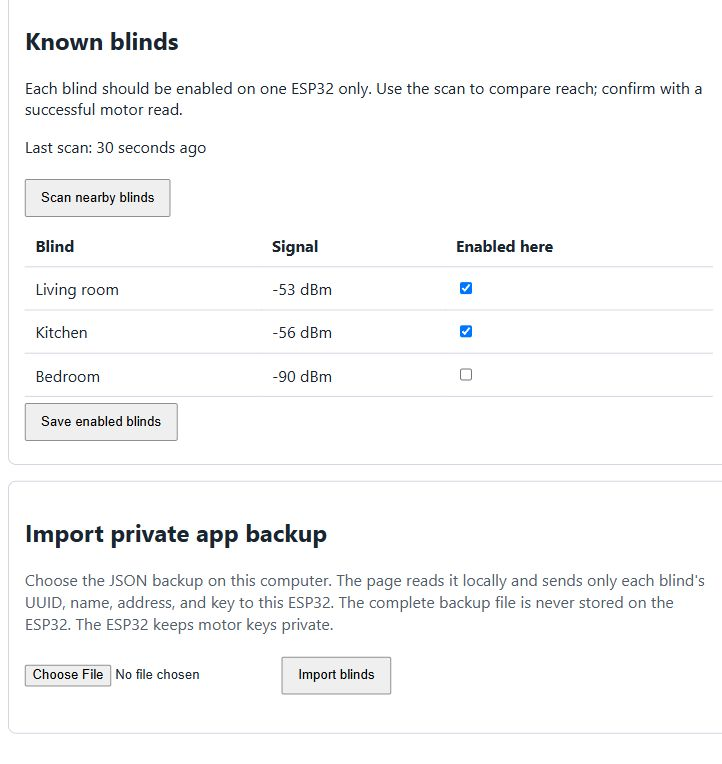
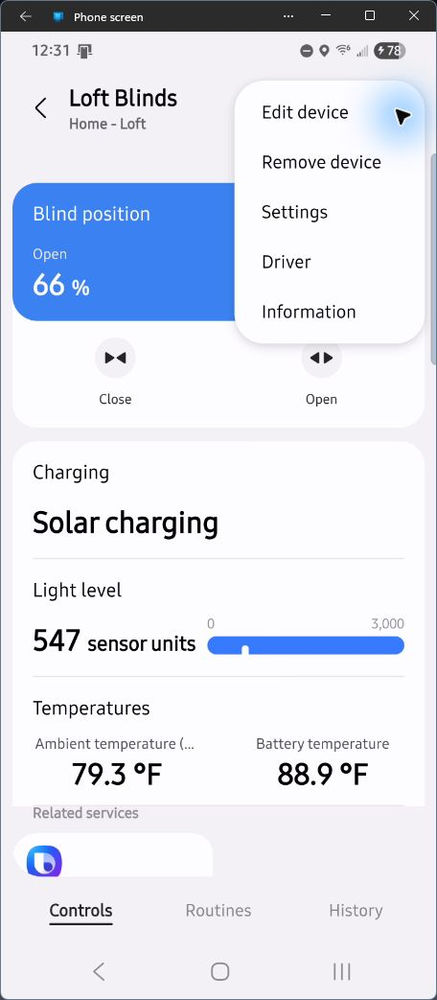
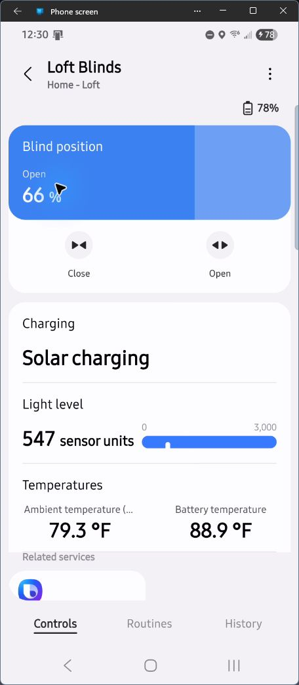
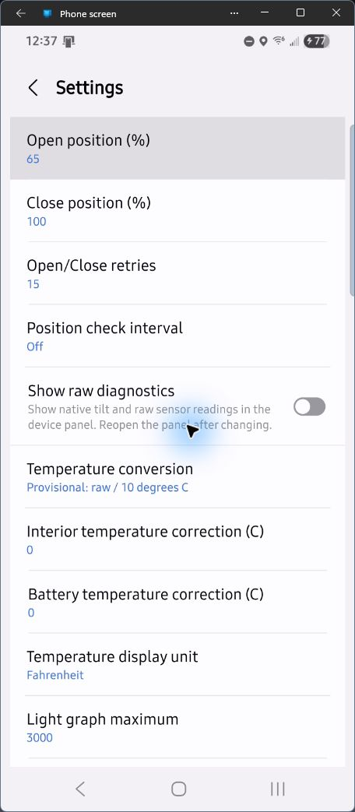
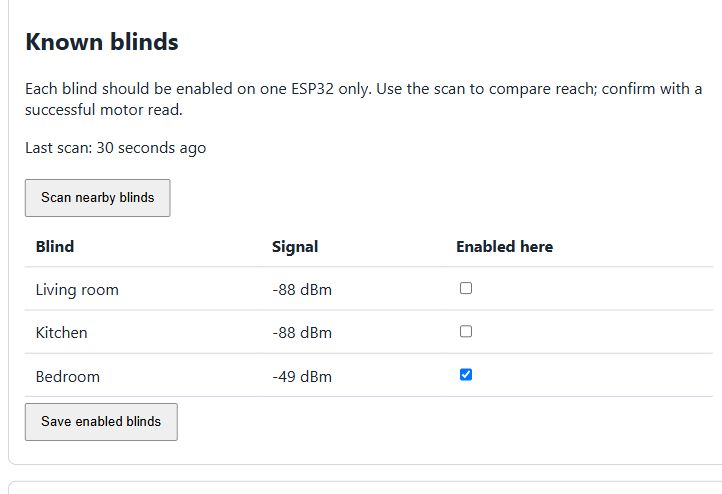

# Beginner installation guide

Follow these steps in order. Start with one board and one blind; add more after
that blind works. A **firmware upload** installs the program on the ESP32. An
**Edge driver** installs on your SmartThings hub. You need both.

The bridge connects your existing blind motors to SmartThings without the
retired MySmartBlinds cloud bridge. SmartThings provides remote app access and,
when linked to Alexa, the route for voice commands. The ESP32 does not connect
directly to Alexa.

Screenshots below show the real GitHub and SmartThings Android interfaces. The
bridge setup-page images are clearly labeled examples rendered from the firmware
with sample data. Android values are from a customized installation, not defaults;
follow the written recommendations. See [image details](screenshots/README.md).

## 1. Check the equipment

Use the equipment listed in the [README](../README.md). The validated board
family is the classic ESP32-WROOM-32/32D development board. **ESP32-WROOM-32U
USB development boards are expected to work with the same firmware**, but have
not been physically validated here and require the correct external 2.4 GHz
antenna. Attach it before powering the board. Keep the supplied `esp32dev`
configuration; the `esp32-wroom-32d` task name is only an environment label.

Read the [hardware compatibility and step-by-step 32U guide](HARDWARE_COMPATIBILITY.md)
for board identification, antenna requirements, other classic WROOM variants,
and variants that the supplied build does not support. A bare WROOM module is
not a complete USB development board. This guide uses
Windows and Visual Studio Code with PlatformIO. The PlatformIO project can also
be built on macOS/Linux, but the USB port names and driver steps differ.

Charge the blind and verify it moves with the original app. Leave its existing
calibration in place. This project does not repair or recalibrate a motor.

## 2. Export your private blind backup

1. Open the MySmartBlinds **Android** app that already controls your blinds.
2. Use its backup/export feature to save a JSON backup. The exact menu wording
   depends on app version. The official [Android app listing](https://play.google.com/store/apps/details?id=com.mysmartblinds2.android)
   confirms backup export/import support; this guide does not assume a specific
   menu path. Do not reset or remove your blinds to produce the backup.
3. Transfer the JSON file to a private folder on your computer, outside this
   downloaded project. Keep an unchanged spare copy. Do not upload it to GitHub.
4. You will select this file on the ESP32 setup page in step 6. The tested format
   has `user.rooms[].blinds[]`, including `id`, `name`, `encodedMacAddress`, and
   `encodedPasskey`. You do not have to decode or edit it.

If you cannot export a compatible backup, stop here: this project cannot guess
the motor pairing keys. iOS exports have not been validated for this importer.
The backup is sensitive even though some fields are encoded.

## 3. Download the project and install the build tool

1. On the GitHub repository page, choose **Code → Download ZIP**.
2. Right-click the ZIP and choose **Extract All**. Extract to a local folder such
   as `C:\Projects\MySmartBlinds`. Avoid OneDrive-synced folders for development
   tools and build files. Do not open the project from inside the ZIP.
3. Install [Visual Studio Code](https://code.visualstudio.com/).
4. Open Visual Studio Code, select **Extensions**, search for **PlatformIO IDE**
   by PlatformIO, and install it. Let its setup finish, then restart the editor
   if requested. See [PlatformIO installation help](https://docs.platformio.org/en/latest/integration/ide/vscode.html).
5. Choose **File → Open Folder**, and open the **`esp_bridge`** folder inside
   the extracted project. This folder contains `platformio.ini`.

No Wi-Fi password or blind key belongs in the source code. The supplied firmware
asks for those through its local setup page after installation.



*Choose Code, then Download ZIP on this project's GitHub page.*

## 4. Upload the firmware to the ESP32

1. Connect the ESP32 with a USB **data** cable. Some charging cables carry no data.
2. Open the PlatformIO sidebar (alien-head icon). Under **Project Tasks →
   esp32-wroom-32d → General**, select **Build**. The first build downloads
   development tools and may take several minutes. Wait for **SUCCESS**.
3. Select **Upload** in the same task list. If multiple boards are connected,
   disconnect the others so there is no doubt about the upload target.
4. If the console stays at `Connecting...`, hold **BOOT**, start Upload again,
   and release BOOT as soon as writing begins. If necessary, briefly press EN
   while holding BOOT to enter download mode. Release BOOT before the final reset.
5. Wait for **SUCCESS**, then press **EN/RESET** once if the board does not restart.

Do not select Erase Flash for a routine update: saved Wi-Fi and blind settings
are intended to survive a normal upload. Do not flash this firmware onto a
board that must retain a different application.

Checkpoint: after roughly ten seconds, a new board should advertise Wi-Fi
`MSB-Setup-xxxx`. The final four characters vary by board.

## 5. Connect the ESP32 to your home Wi-Fi

1. On your phone or computer, join `MSB-Setup-xxxx` with password
   **`MySmartBlinds`**. Stay connected if warned that it has no internet.
2. In a browser enter **`http://192.168.4.1/setup`**. Include `http://`.
3. Choose your home **2.4 GHz** Wi-Fi name, enter its password, and select
   **Save Wi-Fi**. Leave the optional bridge token blank to generate one.
4. **Copy the displayed LAN token before selecting Connect to Wi-Fi now.**
   Save it privately, for example in a password manager. SmartThings will need it.
   The token is different from the setup Wi-Fi password.
5. Select **Connect to Wi-Fi now**. The ESP restarts and the temporary network
   disappears. Rejoin your home Wi-Fi on the phone/computer.
6. Use the confirmation page's bridge setup link, or enter the shown address
   `http://msb-xxxx.local/setup`. If `.local` does not work, find `msb-xxxx` in
   your router's connected-device list and open `http://ITS-IP-ADDRESS/setup`.
7. On home Wi-Fi, sign in with username **`msb`** and password
   **`MySmartBlinds`**. These are the current firmware's shared setup credentials.

Checkpoint: the setup page opens while your phone/computer is on home Wi-Fi.
Keep the token private. Do not forward the ESP's ports through your router.



*Setup-page example with sample data. Select your own 2.4 GHz network and enter
its password; the sample values are not credentials for your board.*

## 6. Import the backup and enable one blind

1. Close the original MySmartBlinds app so it releases its Bluetooth connection.
2. Open the ESP32's `/setup` page on your trusted home Wi-Fi.
3. Under **Import private app backup**, choose the JSON file from step 2 and
   select **Import blinds**. The browser reads the file and sends the blind
   records to your ESP32. The whole backup is not stored on the ESP32.
4. Wait for the restart and reload the page. Imported blinds start disabled.
5. Use the range scan on the setup page if needed, then check **Enabled here**
   for one nearby blind and select **Save enabled blinds**.
6. Keep other boards from being assigned that same blind. Later you can enable
   additional blinds here, up to ten records total per board.

Motor keys are stored on the ESP32. The setup page uses local HTTP, so perform
the import only on a trusted network. The optional USB method below avoids
sending motor keys over Wi-Fi.



*Example after import: Living room and Kitchen are enabled on this bridge;
Bedroom is stored but disabled. Start by enabling just one nearby blind.*

## 7. Install the SmartThings Edge driver

Use the [MySmartBlinds Community invitation](https://bestow-regional.api.smartthings.com/invite/gV2qaXZ9de29).
Downloading the source does not install a driver on your hub.

1. Open the community channel invitation from the README.
2. Sign in with the Samsung account that owns your SmartThings hub.
3. Select **Accept**, find your hub, and select **Enroll**.
4. Select **Available Drivers**, choose **MySmartBlinds ESP Bridge**, and
   select **Install**. Enrollment alone does not install the driver.
5. In the SmartThings app, select your hub's location. Choose **Add device** and
   **Scan nearby** (wording may vary by app version). Keep the ESP32 powered on.
6. Look for a **MySmartBlinds Bridge** setup device and your enabled blind.
   Discovery may take time; run the scan again if needed.
7. Open the bridge setup device → menu → **Settings** → **Bridge token**.
   Paste the token saved in step 5 and save. Each board needs its own token.
8. Open the blind and pull down to refresh. Allow time for the ESP to connect
   over Bluetooth and return the reading. Reopen the device page if its layout
   has not loaded yet.

The [official channel installation guide](https://developer.smartthings.com/docs/devices/hub-connected/enroll-in-a-shared-channel)
describes invitation acceptance, hub enrollment, and driver installation.



*On an opened device, use the top-right menu → Settings. Enter the private token
on the bridge setup device; configure movement and polling on each blind.*

## 8. Test and customize one blind

Read the [SmartThings driver features and settings guide](SMARTTHINGS_DRIVER_GUIDE.md)
for every setting, polling's battery tradeoff, and retries for motors that
intermittently stop short. Temperature and light conversion remain experimental.

1. Watch the blind while testing. Move the slider to **50%**: its slats should
   become approximately flat/open. **0% and 100% are opposite closed directions.**
2. Use **Open** and **Close**. Defaults are Open 50%, Close 0%. Adjust **Open
   position (%)** and **Close position (%)** in that blind's Settings if needed.
3. Pull down to refresh and check that the measured position and battery update.
   An accepted request is not proof the motor moved; verify it physically.
4. Leave **Open/Close retries** at **0** initially. Higher settings permit extra
   movements and can take several minutes. A small limit can help a motor that
   intermittently stops short, but it cannot repair a mechanical fault. The driver
   uses reported motor position, which may not reveal a slipping linkage.
5. Choose **Position check interval**. Default is 2 minutes. **Off** stops routine
   checks after bounded startup work; commands and manual Refresh still work.
   Polling uses additional Bluetooth communication and may reduce motor battery
   life. Consider Off if you mainly issue SmartThings/Alexa commands; enable it
   when you need updates from other control methods or fresh sensor readings.
6. Temperature and light interpretation are tentative and have not been confirmed
   accurate. Leave temperature conversion disabled and lux calibration at zero
   until checked against suitable reference instruments. Raw light is not lux,
   and selecting Confirmed does not validate a temperature conversion.
7. Add your remaining blinds in the setup page, then run SmartThings discovery
   again. Each blind becomes a separate device for routines. Correct display
   names manually if SmartThings adds a numeric suffix.

Once SmartThings control works, you can use normal SmartThings routines.



*Actual Android controls showing one installation's live readings. The light bar
uses sensor units, and the displayed temperatures are provisional, not verified
room or battery temperatures. Your labels and readings may differ.*



*Customized example: Open 65%, Close 100%, retries 15, polling Off. These are
**not defaults or beginner recommendations**. Start with retries 0; for a motor
that occasionally stops short, observe it with a small limit such as 1–3.
The shipped polling default is 2 minutes; Off can reduce battery use.*

## Use remote control and Alexa

First verify that each blind moves from its device page in SmartThings. The
ESP32 and SmartThings hub must stay powered and connected to your home network.

For **remote access**, leave the hub connected to the internet. On your phone,
turn off Wi-Fi to use mobile data, open SmartThings, and test a blind. This
checks the SmartThings remote-control route rather than the original
MySmartBlinds app or retired bridge.

For **Alexa**, the route is Alexa → SmartThings → your hub's Edge driver →
ESP32 → blind. Link the accounts after SmartThings control works:

1. Open the Alexa app and find the **SmartThings** skill under Skills & Games.
2. Enable it and sign in to the Samsung account that owns your SmartThings home.
   Follow the account-linking and device-access prompts.
3. Run Alexa device discovery and look for the blinds added through SmartThings.
4. Give each blind a clear name in Alexa. Test an Open/Close command for one
   blind before adding it to Alexa groups or routines. Available voice commands
   depend on the device controls Alexa exposes through SmartThings.
5. If an old MySmartBlinds device still appears in Alexa, make sure your test
   targets the newly discovered SmartThings device; review duplicate device names.

See [Samsung's current Alexa linking instructions](https://www.samsung.com/us/support/answer/ANS10006871/)
if app wording differs. Use the SmartThings skill for this solution. Remote
access and Alexa need internet service; local Bluetooth communication between
the ESP32 and motors does not restore the retired manufacturer's cloud service.

## 9. Use multiple ESP32 bridges for better coverage

One ESP32 can control several blinds. You do **not** need a separate ESP32 for
every blind. Add another bridge when one location cannot reliably reach all of
your motors over Bluetooth—for example, in a house with multiple floors, distant
rooms, thick walls, or blinds at opposite ends of the building.

Each ESP32 needs both a reliable Wi-Fi connection to your home network and a
reliable Bluetooth connection to its assigned blinds. Good Wi-Fi by itself does
not guarantee that it can reach a blind over Bluetooth. Moving a bridge closer
or adding one near a distant group can help with weak-signal command failures.
It does not repair a motor's mechanical problems.

All bridges use the **same firmware and the same SmartThings driver**:

```text
                         -> ESP32 near downstairs blinds -> downstairs motors
SmartThings hub -> LAN
                         -> ESP32 near upstairs blinds   -> upstairs motors
```

The ESP32s connect independently to your network. They do not form a Bluetooth
mesh, repeat each other's radio signals, or automatically take over each other's
blinds. Each board has its own setup address, configuration, and LAN token.

### Set up and assign an additional bridge

1. Flash another compatible ESP32 with this project's firmware, following steps
   3–5. Set up one new board at a time so you know which setup network belongs to it.
2. Connect it to the same reachable home LAN as your SmartThings hub. Save its
   setup hostname/IP address and its own LAN token separately from your other
   bridge's details. Leave it powered near the blinds it will serve.
3. Import the same compatible app backup on the new board's `/setup` page. A
   newly configured bridge starts with the imported blinds disabled. A bridge
   can know a blind's record without being assigned to control it.
4. On each bridge's setup page, run a range scan and compare which blinds are
   visible. Repeat scans if a motor is missed. Choose the bridge with reliable
   coverage for each blind; a scan is a placement aid, not proof of control.
5. Check **Enabled here** only for the blinds this board should control and
   select **Save enabled blinds**. **Assign each blind to exactly one bridge.**
   If moving a blind from an existing bridge, first uncheck it there and save;
   then enable it on the new bridge and save. Saving assignments restarts the board.
6. Run **Scan nearby** again in SmartThings. You install the Edge driver only
   **once per hub**, not once per ESP32. Discovery finds each bridge and its
   assigned blinds.
7. Open the new **MySmartBlinds Bridge** setup device → **Settings** → **Bridge
   token**, enter that board's token, and save. Do this for every additional bridge.
   Each blind automatically uses the token of its assigned bridge.
8. Refresh and test each moved/new blind from SmartThings. Observe physical
   Open/Close movement from the bridges' intended locations before relying on routines.

For example, the same backup can be imported into both boards, with assignments
like these:

| Blind | Downstairs bridge: Enabled here | Upstairs bridge: Enabled here |
| --- | --- | --- |
| Living room | Yes | No |
| Kitchen | Yes | No |
| Bedroom | No | Yes |



*Compare with the downstairs example in step 6: only Bedroom is enabled here.
The same backup can be stored on both boards, with each blind enabled on one.*

The driver routes each blind's commands to its assigned bridge. Users continue
to see one SmartThings device per blind and can include blinds from different
bridges in the same routines or Alexa groups through SmartThings. There is no
separate Alexa account link for each ESP32.

### Moving blinds between bridges and current limits

The driver identifies a blind by the UUID imported from your backup, rather than
by the ESP32's address. After changing assignments and rerunning discovery, it
can route the existing SmartThings blind device to the new bridge. Keep the same
blind UUID; normally you do not need to delete/recreate the SmartThings device
or rebuild its routines simply to change its bridge.

If a blind is enabled on two bridges, the driver treats that as a conflict and
blocks its command routing until the overlap is fixed. If it is enabled nowhere,
no bridge is assigned to control it. If a bridge goes offline, its blinds have
no automatic failover; restore that board or deliberately reassign them to a
reachable board.

Each bridge supports **up to ten stored blind records, including disabled
records**. The current backup importer rejects a file with more than ten blinds;
adding boards does not automatically bypass that import limit. Additional bridges
are useful for coverage and distributing work, but this guide does not claim an
unlimited number of blinds or a tested maximum number of ESP32s.

Each board processes its own Bluetooth work serially. Spreading blinds across
boards can distribute that work, but movement across a group is not synchronized
and faster completion is not guaranteed. Polling and retry battery costs still
apply to each motor; see the [driver guide](SMARTTHINGS_DRIVER_GUIDE.md).

## Optional: USB provisioning instead of web import

This is an advanced alternative. Install Python 3.10+ from
[python.org](https://www.python.org/downloads/), then open PowerShell in the
extracted project root. Replace COM6 with your board's port from Windows Device
Manager → Ports. Close serial monitors before running these commands.

```powershell
py -m pip install -r requirements-tools.txt
py esp_bridge/configure.py --backup "$HOME\Downloads\MSB_BACKUP.json" --list
py esp_bridge/configure.py COM6 --backup "$HOME\Downloads\MSB_BACKUP.json" --assign 1
```

The first command lists blind numbers. The second assigns blind 1 and privately
prompts for Wi-Fi credentials. Supply your actual backup filename. Multiple
numbers can follow `--assign`. The LAN token is saved outside the project in
`%LOCALAPPDATA%\MySmartBlinds\bridge_token.txt` on Windows. Copy that private
token into the SmartThings bridge device's Settings. Do not post it in an issue.

For an existing configured board, `--reuse-network` keeps its Wi-Fi settings;
it requires the same private token file. For multiple boards with different
tokens, use a distinct `--token-file` path per board.

## Problems?

Use [Troubleshooting](TROUBLESHOOTING.md). When asking for help, include the board
model, firmware version, and a description of what failed. Omit your backup,
tokens, passwords, motor addresses, and personal device identifiers.
