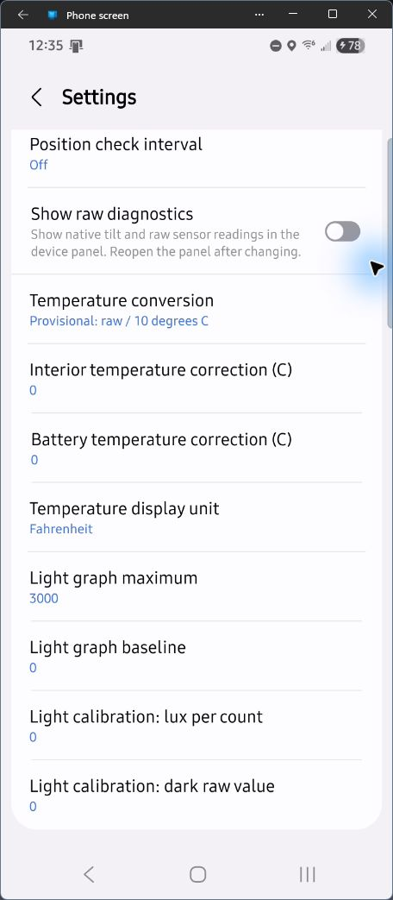

# SmartThings driver: features and settings

This guide explains the **MySmartBlinds ESP Bridge** Edge driver after you have
installed it and discovered your blinds. For hardware, Wi-Fi, backup import, and
driver installation, follow the [beginner guide](BEGINNER_GUIDE.md).

Jump to [multiple bridges](#multiple-bridges-and-blind-assignments),
[controls](#controls-and-readings), [basic settings](#basic-settings),
[polling and battery life](#polling-when-to-turn-it-on-and-the-battery-cost),
[Open/Close retries](#openclose-retries-helping-motors-that-intermittently-stop-short),
or [experimental temperature and light](#temperature-and-light-experimental-readings).

The driver runs on your SmartThings hub. It sends commands to the ESP32 over your
home network; the ESP32 communicates with the motors over Bluetooth. Alexa reaches
these devices through the **SmartThings skill and linked account**.

## Multiple bridges and blind assignments

Use more than one ESP32 when a single board cannot reliably reach all your motors
over Bluetooth, such as across floors or distant rooms. Each bridge connects to
the same reachable LAN as your hub and serves the blinds assigned to it. One
driver installation on the hub discovers all the bridges; each bridge setup device
needs its own board's LAN token.

Enable a blind on **exactly one** bridge's setup page. The driver automatically
routes its commands to that board. A duplicate assignment blocks routing until
corrected. Each board can store up to ten blind records, including disabled ones;
the current importer does not accept a backup with more than ten records.

When reassigning a blind, disable it on its old board and save, then enable it on
the new board and save. Run SmartThings discovery again. The stable blind UUID
lets the driver reuse the existing blind device when its bridge changes. There
is no automatic roaming or failover if a bridge goes offline, and the ESP32s do
not act as radio repeaters for one another.

Blinds on different bridges can be used together in SmartThings routines and
Alexa groups through SmartThings. Each board handles its own motor transactions
serially, so group movement is not synchronized. Extra boards do not remove the
battery cost of polling or retries. Follow the
[multiple-bridge setup steps and example](BEGINNER_GUIDE.md#9-use-multiple-esp32-bridges-for-better-coverage)
for placement, range scans, per-board tokens, and verification.

## Find the controls and settings

Discovery creates a **MySmartBlinds Bridge** setup device for each ESP32 and a
separate SmartThings device for each enabled blind.

1. In SmartThings, open the bridge setup device → menu → **Settings** and enter
   its **Bridge token**. Its assigned blinds then use that token automatically.
2. Open an individual blind to see its tilt, Open/Close, battery, and sensor panel.
3. Open that blind's menu → **Settings** to change its presets, polling, retries,
   and sensor display options. Settings apply to that blind individually.
4. Save your changes. Close and reopen the device page after changing **Show raw
   diagnostics** so the new panel layout can load. App wording may vary.

## Controls and readings

*Genuine Android capture from one customized installation. Sensor values can be
old; the temperature interpretation is provisional. The light bar is in sensor
units, not confirmed lux. App layout can vary by version.*

| Item | What it does |
| --- | --- |
| Open / Close | Moves to the Open or Close position you selected in Settings |
| Tilt slider | Selects a tilt through the full range: **50% is flat/open; 0% and 100% are opposite closed directions** |
| Blind status | Shows Open, Closed, or Partially open based on reported motor position and the configured presets |
| Refresh | Pull down on the blind's page to request a fresh Bluetooth reading, including when routine polling is Off |
| Battery | Shows the most recently reported battery percentage |
| Charging | Indicates solar, USB, both, or no charging from the motor's reported status |
| Light | Shows a relative reading in **sensor units**, with a current-value bar |
| Temperature | Optional experimental conversions of motor-interior and battery sensor values; see the limitations below |
| Raw diagnostics | Optional native position and unconverted telemetry for investigation |

The slider measures **tilt**, not how far the blind is raised. The driver does
not provide a lift function or a Pause control. The old On/Off command aliases
remain for compatibility and use the Open/Close presets.

An accepted command means the bridge queued the request, not proof of physical
movement. Readback is used to reconcile the displayed target with reported motor
position. Group commands are handled serially; several blinds may move at
different times. Opening a device page alone does not guarantee a fresh motor read.

## Basic settings

Open the device's top-right menu and choose **Settings**:

*This real installation uses custom values: Open 65%, Close 100%, retries 15,
and polling Off. **Do not treat these as defaults or recommended starting
settings.** The maximum retry limit of 15 can cause substantial extra motor work;
use 0 for reliable motors or try 1–3 while observing an intermittent motor.
The private bridge token is above the captured area and is not shown.*

| Setting | Default / choices | Meaning |
| --- | --- | --- |
| Bridge token | Blank | Private LAN token from ESP32 setup. Normally enter it on the bridge setup device. A token field on an individual blind is a fallback; a valid bridge-device token takes priority. |
| Open position (%) | 50; range 0–100 | Target used by Open. Choose the tilt that gives the opening you want. |
| Close position (%) | 0; range 0–100 | Target used by Close. 0 and 100 close in opposite directions. Choose a different target from Open. |
| Position check interval | **2 minutes**; Off, 1, 2, 5, 10, 15, or 30 minutes | How often the ESP32 requests a motor reading outside of commands and manual Refresh. See the battery tradeoff below. |
| Open/Close retries | **0**; range 0–15 | Maximum extra movement attempts for an Open/Close command. 0 disables these extra attempts. |
| Show raw diagnostics | Off | Adds native position and raw telemetry to the panel. Reopen the page after changing it. |

## Polling: when to turn it on, and the battery cost

**Polling can use more motor battery.** Each scheduled reading requires Bluetooth
communication with the battery-powered motor, even when you have not asked the
blind to move. Shorter intervals mean more frequent communication. Weak Bluetooth
coverage and failed reads can add connection work. The effect on battery life
has not been quantified; solar charging does not guarantee that it offsets this use.

Enable polling when you need SmartThings to learn about changes made **outside
this driver's commands**, such as adjustments in the original Bluetooth app or
the motor's own schedules. It is also useful when you need periodically refreshed
battery, charging, light, or temperature telemetry for a display or routine.
Polling requests sensor data as part of the motor transaction; the setting's name
does not mean it updates only position.

| Your use case | A reasonable starting point |
| --- | --- |
| You mainly use SmartThings/Alexa Open/Close commands or routines and want to reduce battery use | **Off**, with manual Refresh when you need a fresh reading |
| You occasionally adjust blinds through another control method, or want occasional sensor/battery updates | Try **15 or 30 minutes**, then shorten only if the delay is inconvenient |
| You need faster awareness of outside changes or more frequent telemetry | Choose a shorter interval, accepting additional battery use and Bluetooth traffic |

The shipped default is **2 minutes**; that is a software default, not a measured
battery-life recommendation. Choose the longest interval that meets your needs.
Position polling is **not required for Alexa control, scheduled SmartThings
commands, or the Open/Close retry feature**.

With **Off**, routine reads stop after bounded startup work. Movement commands,
their confirmation reads, and manual Refresh can still contact the motor, so Off
does not mean zero battery use. Between those operations, SmartThings keeps the
last known readings. Changes from another app or a motor schedule can remain
unseen, and a displayed battery or sensor value can be old.

The driver also checks the ESP32's cached state about once a minute over the LAN.
That is different from waking the motor for a new Bluetooth reading: repeated
cached values do not prove a fresh measurement. Bluetooth work is shared among
assigned blinds, so a chosen interval is not an exact reporting deadline.

## Open/Close retries: helping motors that intermittently stop short

Some aging motors intermittently fail to complete an opening or closing movement.
For example, a motor may stop short on one attempt and reach the target on the
next. **Open/Close retries** gives that same target additional chances without
requiring you to issue another voice command or press Open/Close again.

This can help with an intermittent mechanical stall or incomplete movement when
another attempt succeeds. It does not repair a damaged, slipping, or jammed
mechanism, and it cannot guarantee that the slats physically reached the target.
The driver relies on the motor's reported position. If the motor reports success
while a slipping linkage leaves the slats misaligned, the driver may stop retrying.

### What the number means

- **0**: initial command only, with no extra movement attempts from this setting.
- **1**: initial command plus at most **1** extra attempt.
- **3**: initial command plus at most **3** extra attempts, for up to **4** accepted
  movement requests in the sequence.
- **15**: initial command plus at most **15** extra attempts, for up to **16**.

These are permitted requests, not a promise that the motor moved each time.
The setting applies to Open/Close preset commands, including their legacy On/Off
aliases. It does **not** add movement attempts to slider or native-position commands.
Alexa benefits when its request reaches SmartThings as one of those preset commands.

### How a retry sequence works

1. The driver sends the selected Open/Close target and checks the reported result.
2. With extra attempts enabled, it first checks cached results for roughly 30
   seconds. It then requests a fresh motor reading if success is still unconfirmed.
3. A fresh reading showing a missed target allows another attempt once the bridge
   confirms delivery of the previous command, has no queued movement, and is idle.
4. If fresh position data cannot be obtained, the driver can request up to three
   fresh reads before deciding whether to repeat the target. Missing position
   feedback alone does not discard the remaining movement attempts: it can still
   repeat when delivery of that exact command and an idle bridge are confirmed.
   It stops if that delivery/state cannot be established or a permanent request
   rejection occurs.
5. Every extra movement repeats **the same absolute target** and consumes one
   extra attempt. It does not progressively change the target or recalibrate the motor.
6. Confirmed success ends the sequence early. A newer command cancels the old
   sequence. Setting retries to 0 prevents further extra movements; it does not
   undo a movement already delivered. Retries do not resume after a driver restart.

For Open/Close targets at **0% or 100%**, a reported position within **3 percentage
points**, including the boundary, counts as success. Other preset targets use a
tighter tolerance of one native motor count, approximately half a percentage point.

**Retry timing is not a fixed delay between movements.** Bluetooth reads, bridge
availability, and network timeouts can make a sequence take several minutes or
longer, especially with a large retry limit. A sequence does not keep monitoring
forever: later manual adjustments do not restart a completed command.

For a motor with intermittent problems, start with **1–3 extra attempts**, observe
several Open/Close cycles, and use the lowest useful limit. Extra movements and
confirmation reads consume battery and add motor use. Avoid using a large retry
limit to repeatedly drive a motor that remains jammed or fails every attempt.

The bridge and driver also have separate handling for temporary network and
Bluetooth delivery failures. Setting this preference to 0 does not disable that
underlying delivery handling. It controls additional attempts to complete a
movement after a delivered Open/Close request.

## Temperature and light: experimental readings

**The physical interpretation of the temperature and light data is tentative.
These conversions have not been confirmed to produce accurate temperatures or
lux readings across devices and conditions.** A plausible number or a smooth graph
does not establish calibration. Use the readings for experimentation and relative
trends until you have independently checked them.

### Temperature settings

*Real sensor preferences, with Provisional conversion enabled in this example.
Leave temperature conversion disabled unless independently checked. The pictured
light graph maximum of 3000 is customized; the default is 1000. The graph range
does not calibrate the sensor. Lux calibration remains 0 in this example.*

| Setting | Default / choices | What to know |
| --- | --- | --- |
| Temperature conversion | **Unverified: hide temperatures**; Provisional or Confirmed raw / 10 degrees C | Both enabled modes use the same proposed conversion. Selecting Confirmed does not perform a calibration or certify accuracy. |
| Interior temperature correction (C) | 0; range −50 to +50 | Offset added to the proposed motor-interior conversion, in Celsius |
| Battery temperature correction (C) | 0; range −50 to +50 | Independent offset for the proposed battery conversion, in Celsius |
| Temperature display unit | Fahrenheit; Fahrenheit or Celsius | Changes display units for enabled conversions; it does not improve accuracy |

The proposed formula is **raw / 10 + the selected Celsius correction**. The
interior reading may be labeled "Ambient" in the panel, but it is from **inside
the motor**, not a confirmed room-air thermometer. The battery reading is a
separate internal sensor. Check each sensor against an appropriate reference at
multiple temperatures before relying on the scale or an offset; matching one
temperature does not establish accuracy elsewhere.

Provisional and Confirmed values can look identical in the app. The driver's
temperature-readiness value of `ready` means conversion is enabled with usable
data; it does not prove the conversion has been verified. Keep conversion disabled
if you have not validated it yourself.

### Light settings

| Setting | Default / choices | What to know |
| --- | --- | --- |
| Light graph maximum | 1000; range 1–32767 | Sets the upper reference for the relative light bar. Higher readings can expand its range. |
| Light graph baseline | 0; range 0–32766 | Sets the lower reference for the bar. Readings below it remain visible. A nighttime baseline is not verified zero lux. |
| Light calibration: lux per count | **0**; range 0–10000 | 0 disables lux reporting. A positive value enables a user-supplied linear estimate. |
| Light calibration: dark raw value | 0; range −32768 to +32767 | Raw offset used by the optional lux estimate |

The normal light bar shows **sensor units**, not lux, a percentage of daylight,
or a calibrated brightness scale. It is a current-value bar, not a time-series
chart. Its baseline and maximum change the display range, not the underlying
measurement or its accuracy.

The optional estimate is **(raw light − dark raw value) × lux per count**, bounded
to 0–100000. A positive scale is not evidence that a linear lux conversion is
correct. Leave it at 0 unless you have checked the relationship against a light
meter at multiple light levels. Prefer relative raw thresholds for experiments,
and validate them in the blind's actual location.

### Using sensor readings in routines

Use polling or manual Refresh when a routine needs recent measurements. With
polling Off, sensor values can remain unchanged for long periods. Selecting an
enabled conversion can expose provisional numeric values to routine conditions,
not just to the device panel. Turning conversion off suppresses new converted
events, but older values can remain in SmartThings state or history. Check
readiness, calibration settings, and the age of the actual measurement before
relying on a value. An old value being shown again is not a new sensor sample.

## Practical starting settings

For straightforward SmartThings/Alexa control with an emphasis on battery life:
keep the default Open/Close presets unless your installation needs different
tilts, consider **polling Off**, leave **retries at 0** for reliable motors, and
leave **temperature conversion disabled** and **lux per count at 0**. Enable a
feature only when you have a use for its additional reads or movement attempts.

For a motor that occasionally stops short, try a small retry limit without
enabling periodic polling. For fresh outside-position or sensor updates, enable
polling at a suitable interval separately. See [Troubleshooting](TROUBLESHOOTING.md)
if control or readings fail.
